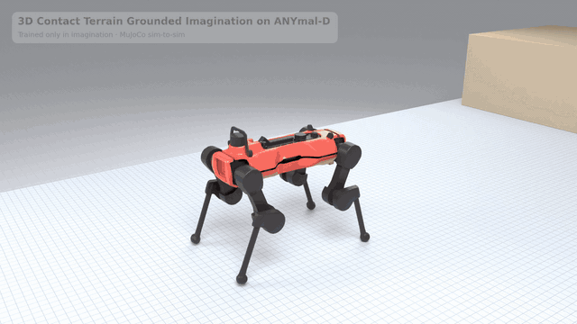

# Terrain-Grounded Imagination

<table>
  <tr>
    <td width="50%"></td>
    <td width="50%"></td>
  </tr>
  <tr>
    <td align="center"><b>2D TGI</b>: Unitree G1</td>
    <td align="center"><b>3D TGI</b>: ANYmal-D</td>
  </tr>
</table>

Terrain-grounded imagination (TGI) trains legged locomotion policies entirely inside a learned world model. This repository contains [2D TGI for the Unitree G1](#2d-tgi-with-unitree-g1) and [3D TGI for ANYmal-D](#3d-tgi-with-anymal-d).

## How it works

- **World model.** Fit to simulator transitions, it predicts the robot's next state and its contact forces from the current state, the action and the terrain around the robot.
- **Terrain from the simulator.** The terrain is not learned: the world model, rewards, terminations, critic and perception read it from the simulator through differentiable lookups, so edges and gaps stay exact in imagination.
- **Training in imagination.** From simulator states, the policy rolls the world model out for 32 steps (0.64 s) and is updated by backpropagating the return through the model and the lookups, with a critic after the last step.
- **Gradient cut.** At imagined touchdowns on poorly supported terrain the backpropagated gradient is unreliable, so the return is cut there and the critic takes over.
- **Foothold perception.** A foothold prediction model (FPM) predicts the next footholds, and the policy sees the terrain only around them, in the simulator and in imagination ([Watch Your Step](https://leggedrobotics.github.io/watch-your-step/)).
- **Impact penalty.** Imagined contact forces above a threshold are penalized, so the policy learns to avoid hard impacts before they happen.
- **Curriculum.** A success-guided sampler picks the terrain types and difficulties.

## Installation

Tested on Linux with Isaac Lab 3.0.0 (Isaac Sim 6.1, Newton 1.6.1, PyTorch 2.11). Install [Isaac Lab 3.0](https://isaac-sim.github.io/IsaacLab/), then, in its Python environment:

```bash
git clone https://github.com/leggedrobotics/terrain-grounded-imagination
cd terrain-grounded-imagination
pip install -e fpm --no-deps
pip install -e tgi
pip install -e tgi_anymal
```

`fpm/` holds the G1 environments and the FPM of [foothold-prediction-model](https://github.com/leggedrobotics/foothold-prediction-model), `tgi/` the 2D G1 training and `tgi_anymal/` the 3D ANYmal-D training.

## 2D TGI with Unitree G1

- **Environment.** The `fpm` G1 environment on Newton physics: velocity commands over stairs, gaps, pits and stepping stones.
- **Terrain input.** The heightmap under the pelvis and the soles.
- **Contacts.** The world model predicts the sole forces; forces above 450 N are penalized.

### Training

The defaults train the recipe: 8192 environments for 40k iterations, about 7.5 h on an RTX PRO 6000. From `tgi/`:

```bash
python scripts/convert_g1_usd.py   # once
python scripts/train.py --log_dir logs/<run_name>
```

### Export and evaluation

```bash
python scripts/export.py --ckpt logs/<run_name>/ckpt_040000.pt
python scripts/sim2sim.py --export_dir logs/<run_name>/export_040000 --terrains stairs:0.20 fpmstones:0.6 pit:0.30
bash scripts/isaac_eval.sh logs/<run_name>/export_040000/model_40000.pt 520 cuda:0
```

The export is in the `fpm` format, so `python scripts/play.py --checkpoint <export dir>/model_40000.pt` plays it from `fpm/`. `sim2sim.py` runs it in MuJoCo with Unitree's G1 model, and `isaac_eval.sh` runs the `fpm` locomotion validation.

## 3D TGI with ANYmal-D

- **Environment.** Isaac Lab's ANYmal-D rough-terrain task on Newton physics with its ANYdrive LSTM actuator model: reach a goal within 8 s over climbs, gaps, pits, boxes, stairs and stepping stones.
- **Terrain input in 3D.** The distance and direction from each foot and from spheres on the knees, shanks, thighs and body to the nearest surface, including walls.
- **Contacts on every body part.** The world model predicts the contact force on each foot and body part, such as a knee pressing on a wall during a climb or the impact of a landing; foot forces above 600 N are penalized.

### Training

The defaults train the recipe: 4096 environments for 30k iterations, about 5.6 h on an RTX PRO 6000. From `tgi_anymal/`:

```bash
python scripts/train.py --log_dir logs/<run_name>
```

### Evaluation

```bash
python scripts/anymal_term_level.py logs/<run_name>/ckpt_030000.pt
```

reports the success rate and how episodes ended, per terrain type and level.

## Previous Work

TGI builds on:

- [SuperMimic](https://arxiv.org/abs/2610.28480): the training scheme, in which a world model is fit to simulator transitions and the policy is trained by backpropagating the return through short imagined rollouts.
- [Watch Your Step](https://arxiv.org/abs/2610.29612): the foothold-gated perception, the G1 locomotion environments and the validation suites.
- [SHAC](https://arxiv.org/abs/2204.07137): the policy objective, a short-horizon return backpropagated through time and bootstrapped with a critic.
- [Robotic World Model](https://arxiv.org/abs/2501.10100): fitting the world model on autoregressive rollouts, so that it learns from its own compounding errors.

## Citation

If you use this code, please cite:

```bibtex
@misc{heyrman2026tgi,
  author = {Heyrman, Matthias and Hutter, Marco},
  title  = {Terrain-Grounded Imagination: A Recipe for Humanoid Locomotion on Sparse Terrain through World Models},
  year   = {2026},
  note   = {Code: \url{https://github.com/leggedrobotics/terrain-grounded-imagination}},
  url    = {https://github.com/leggedrobotics/terrain-grounded-imagination}
}
```

If you use the foothold prediction model or the G1 environments in `fpm/`, please also cite:

```bibtex
@misc{heyrman2026watch,
  author        = {Heyrman, Matthias and Li, Chenhao and Dadiotis, Ioannis and Hutter, Marco},
  title         = {Watch Your Step: Anticipated Perception for Humanoid Locomotion},
  year          = {2026},
  eprint        = {2610.29612},
  archivePrefix = {arXiv}
}
```

## License

© 2026 ETH Zurich<br>
Created by: Matthias Heyrman and Marco Hutter<br>
Licensed under the MIT License (see [LICENSE](LICENSE)).

Third-party files keep their original license (see [licenses/dependencies](licenses/dependencies)):

- `fpm/src/fpm/assets/data/G1/` is the Unitree G1 (29 DoF, rev 1.0) model from [unitree_ros](https://github.com/unitreerobotics/unitree_ros), converted to USD, BSD-3-Clause.
- `tgi/src/tgi/assets/g1_kinematics.xml` is the Unitree G1 model from [mjlab](https://github.com/mujocolab/mjlab) with the meshes removed, Apache-2.0.
- `tgi/src/tgi/assets/unitree_g1/` is the Unitree G1 (29 DoF) MuJoCo model from [unitree_mujoco](https://github.com/unitreerobotics/unitree_mujoco), BSD-3-Clause.
- `tgi_anymal/src/tgi_anymal/assets/anymal_d_kinematics_col.xml` is the ANYmal-D model from [anymal_d_simple_description](https://github.com/ANYbotics/anymal_d_simple_description) with the meshes removed and collision spheres added, BSD-3-Clause.

The ANYmal-D robot model and its ANYdrive actuator network are not part of this repository; Isaac Lab downloads them from its asset server.
